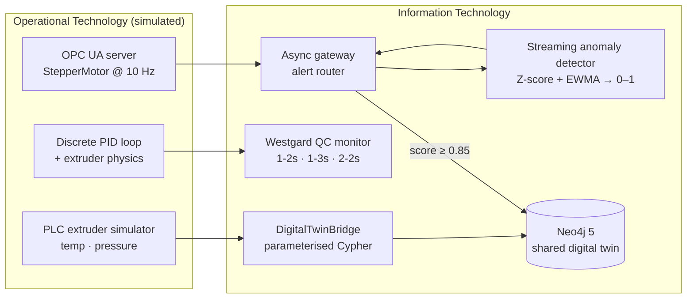
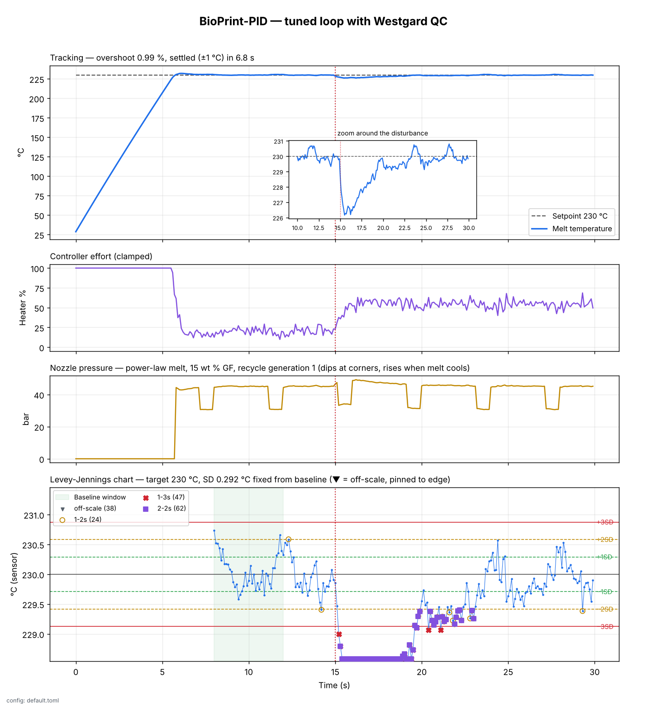

# BioPrint Automation Suite

### Cyber-Physical Digital Twins, Process Control & Industrial AI

[](https://github.com/Thembelitchi/BioPrint-Automation-Suite/releases)


[](LICENSE)

I built this monorepo to show how **Operational Technology (OT)** data from the factory floor can flow into **Information Technology (IT)** systems that make it useful: a knowledge graph you can query, a control loop with statistical quality checks, and a predictive-maintenance pipeline that raises alerts before a machine fails.

Before working with industrial data and knowledge graphs, I spent more than a decade as a Biomedical Technologist in clinical pathology. Clinical labs reject a run when the quality-control numbers drift, not only when a single value breaks a limit. I bring that discipline (Westgard rules, Levey-Jennings charts, traceability) to industrial automation here.

> **Everything here is simulated.** PLC registers, OPC UA nodes, motor telemetry and polymer behaviour are all modelled in Python. No physical hardware is involved. The point is the architecture and the engineering, which carry over to real equipment.

---

## The three sub-projects

| | Project | What it shows | Status |
|---|---|---|---|
| 🏗️ | [**GraphPrint-Twin**](./projects/01_graphprint_twin) | Simulated PLC telemetry streamed into a Neo4j semantic digital twin, with one-query forensic traceback from a defect to its material batch. This project also owns the suite's [shared graph schema](./docs/graph-schema.md). | ✅ v0.2.0 |
| 🧪 | [**BioPrint-PID**](./projects/02_bioprint_pid) | A discrete PID controller with anti-windup regulating a polymer extruder (thermal mass plus a shear-thinning melt model), monitored by clinical Westgard rules (1-2s, 1-3s, 2-2s). | ✅ v0.3.0 |
| 🛡️ | [**BioPrint-Guard**](./projects/03_bioprint_guard) | An async OPC UA server streaming motor current, vibration and temperature at 10 Hz. A gateway scores wear from 0 to 1 and raises maintenance alerts in the same Neo4j twin. | Planned for v0.4.0 |

## Architecture



### BioPrint-PID at a glance



A roller door opens at 15 s. The PID loop recovers within about 5 s, and the Westgard monitor flags the excursion 0.2 s after onset (1-3s, then 2-2s). That is the clinical-lab habit of judging a run by its control results, applied to a polymer extruder.

GraphPrint-Twin and BioPrint-Guard write into **the same graph**. A printer's telemetry and the maintenance alerts on its stepper motor sit on connected nodes, so one query can answer questions like "which walls were printed while this motor was degrading?" More detail is in [`docs/architecture.md`](./docs/architecture.md).

## Quick start

```bash
git clone https://github.com/Thembelitchi/BioPrint-Automation-Suite.git
cd BioPrint-Automation-Suite

# Local Neo4j 5 (browser at http://localhost:7474, no auth)
docker compose up -d neo4j
```

Then run a sub-project, for example GraphPrint-Twin:

```bash
cd projects/01_graphprint_twin
pip install -r requirements-dev.txt
python src/main.py
```

Each sub-project's README has its own run instructions.

## Verification

Every check in the suite runs locally with one command:

```bash
scripts/verify.sh --install   # first run: installs each project's dev requirements
scripts/verify.sh             # lint, all tests, scenario runs, live Neo4j stage
```

It runs Ruff, then each sub-project's tests and scenario runs. If Docker is available, it starts Neo4j with `docker compose` and runs the graph pipeline and its live integration tests; otherwise it reports that stage as skipped. It ends with a pass / fail / skip summary and exits non-zero on any failure.

The same checks are also defined as a GitHub Actions workflow ([`integration-tests.yml`](./.github/workflows/integration-tests.yml)) that can be started manually from the Actions tab.

## Roadmap

| Release | Milestone |
|---|---|
| **v0.1.0** | Monorepo scaffold, docs, verification foundation |
| **v0.2.0** | GraphPrint-Twin |
| **v0.3.0** | BioPrint-PID |
| v0.4.0 | BioPrint-Guard |
| v0.5.0 | Cross-project integration tests in one workflow |
| v1.0.0 | Portfolio release: diagrams, screenshots, demo |

The full history is in the [CHANGELOG](./CHANGELOG.md).

## Repository layout

```text
BioPrint-Automation-Suite/
├── .github/            Optional workflow, issue and PR templates
├── scripts/verify.sh   One-command local verification
├── docs/               Architecture notes and the shared graph schema
├── projects/
│   ├── 01_graphprint_twin/
│   ├── 02_bioprint_pid/
│   └── 03_bioprint_guard/
├── assets/             Images used in the docs
├── docker-compose.yml  Local Neo4j
└── pyproject.toml      Shared lint configuration
```

## About me

**Thembelihle Gumede**, data scientist and AI consultant with a background in clinical pathology, based in Durban, South Africa. I run TG Data Services and lead the Neo4j community in Southern Africa.

[Portfolio](https://tgumede-data-portfolio.netlify.app) · [LinkedIn](https://www.linkedin.com/in/thembelihle-gumede-29a68095) · [GitHub](https://github.com/Thembelitchi)

## License

[MIT](LICENSE) © 2026 Thembelihle Gumede
