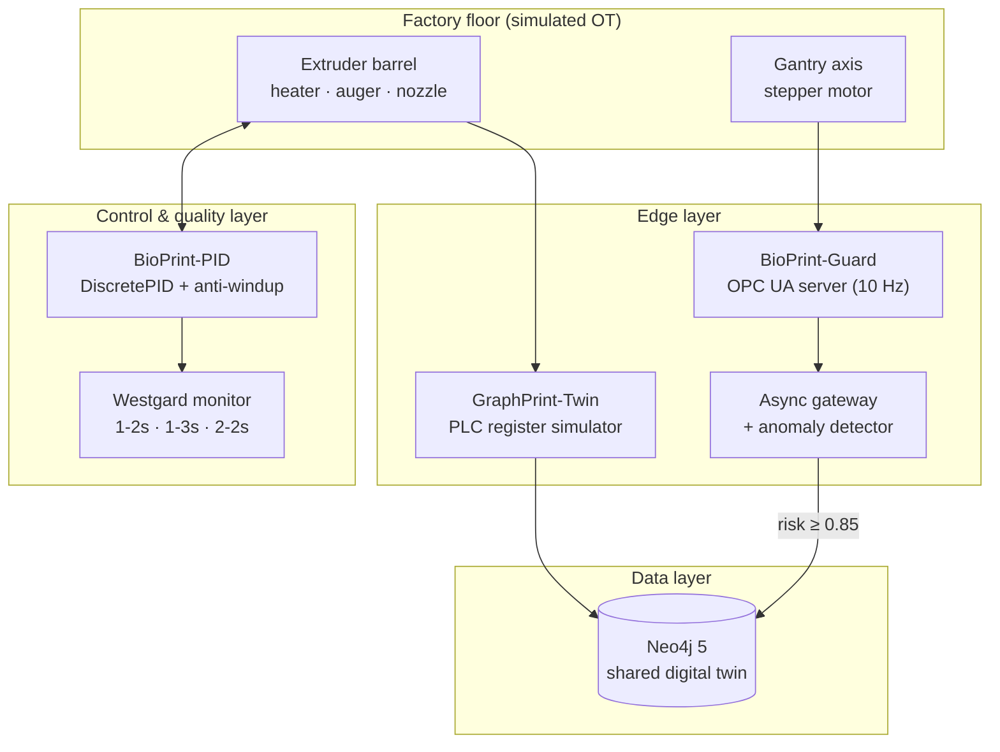

# Architecture

This suite models one part of a large-format polymer 3D-printing line: a gantry printer extruding recycled, glass-fibre-reinforced polymer into structural wall segments. Three sub-projects each cover one layer of the OT → IT stack.

> All equipment and data are simulated.

## End-to-end view

## Design decisions

| Decision | Why |
|---|---|
| **One monorepo, three projects** | Reviewers see the whole OT → IT pipeline in one place, while each project still runs on its own. |
| **One shared graph** | Twin and Guard write into the same Neo4j schema ([graph-schema.md](graph-schema.md)), so telemetry and maintenance alerts connect through the printer. |
| **Layer-bucketed telemetry** | The graph stores one `LayerTelemetry` node per printed layer (stats, anomaly offsets, raw values only when anomalous), not one node per 10 Hz sample: ~120 nodes per printer per day instead of ~864,000. Long raw history belongs in a time-series store, with the graph as the index. |
| **Parameterised, idempotent Cypher** | No string-built queries. Topology uses `MERGE`, so start-up is safe to repeat, and alerts are deduplicated per component. |
| **Clinical QC on an industrial loop** | Westgard rules catch drift and systematic error from the pattern of results, not only from a single value breaking a limit. Control limits are fixed from a stable baseline window, the way a lab sets limits from its control material. |
| **Deterministic simulations** | Fixed random seeds and simulated time by default, so the tests can assert on outcomes. A `--realtime` flag exists for live demos. |
| **Async end to end in Guard** | OPC UA intake, scoring and Bolt writes run as separate `asyncio` tasks joined by a queue, so a slow database write never drops a sample. |
| **Sequenced OPC UA checks** | The server starts first, the check waits for its port, then the gateway runs with a timeout and asserts that exactly one open alert exists in the graph. |
| **Rolling baseline with lag and hold in Guard** | The reference window follows slow benign drift, but readings wait 5 s before entering it and it is held while the motor looks abnormal, so a fault is not learned as normal. A frozen baseline and an Isolation Forest are selectable. |

## Technology

| Layer | Tools |
|---|---|
| Language | Python 3.11 (3.10+ compatible) |
| Graph | Neo4j 5 Community, official `neo4j` Python driver (sync in Twin, async in Guard) |
| Industrial protocol | OPC UA via `asyncua` |
| Numerics & analytics | NumPy, pandas, scikit-learn (optional Isolation Forest) |
| Visualisation | Matplotlib (step response and Levey-Jennings charts) |
| Verification | `scripts/verify.sh` (Ruff, pytest, scenario runs, Neo4j via docker compose); the same checks as an optional manual GitHub Actions workflow |

## Requirements traceability

Each sub-project's README maps its code to the functional requirements (FR-1 to FR-4) in that project's PRD, and the test suite checks each requirement where it can be automated.
