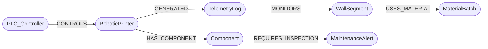

# Shared Graph Schema

GraphPrint-Twin owns this schema, and BioPrint-Guard writes into it. Both connect to the same Neo4j database, so telemetry, components and maintenance alerts form one connected digital twin.

> If you change the schema, change this file first, then the code in both projects.

## Model



## Node labels

| Label | Key properties | Written by |
|---|---|---|
| `PLC_Controller` | `id`, `ip` | Twin (topology) |
| `RoboticPrinter` | `id`, `type` | Twin (topology) |
| `Component` | `id`, `name`, `axis` | Twin (topology); Guard bootstraps if missing |
| `WallSegment` | `id`, `required_layers` | Twin (topology) |
| `MaterialBatch` | `id`, `vendor`, `polymer`, `fibre_pct` | Twin (topology) |
| `TelemetryLog` | `id`, `timestamp`, `nozzle_temp`, `pump_pressure`, `status` | Twin (ingestion) |
| `MaintenanceAlert` | `id`, `status`, `severity`, `peak_risk_score`, `created_at`, `updated_at` | Guard |

`TelemetryLog.status` is either `OPTIMAL` or `ANOMALY_WARNING`.
`MaintenanceAlert.status` is `OPEN` or `CLOSED`; `severity` is `HIGH` (score 0.85–0.94) or `CRITICAL` (≥ 0.95).

## Relationships

| Pattern | Meaning |
|---|---|
| `(:PLC_Controller)-[:CONTROLS]->(:RoboticPrinter)` | Which controller drives which printer |
| `(:RoboticPrinter)-[:HAS_COMPONENT]->(:Component)` | Physical parts of a printer |
| `(:RoboticPrinter)-[:GENERATED]->(:TelemetryLog)` | Which printer produced a reading |
| `(:TelemetryLog)-[:MONITORS]->(:WallSegment)` | What was being printed when the reading was taken |
| `(:WallSegment)-[:USES_MATERIAL]->(:MaterialBatch)` | Material traceability |
| `(:Component)-[:REQUIRES_INSPECTION]->(:MaintenanceAlert)` | Open or historical maintenance alerts on a part |

## Constraints

```cypher
CREATE CONSTRAINT plc_id       IF NOT EXISTS FOR (n:PLC_Controller)   REQUIRE n.id IS UNIQUE;
CREATE CONSTRAINT printer_id   IF NOT EXISTS FOR (n:RoboticPrinter)   REQUIRE n.id IS UNIQUE;
CREATE CONSTRAINT component_id IF NOT EXISTS FOR (n:Component)        REQUIRE n.id IS UNIQUE;
CREATE CONSTRAINT wall_id      IF NOT EXISTS FOR (n:WallSegment)      REQUIRE n.id IS UNIQUE;
CREATE CONSTRAINT batch_id     IF NOT EXISTS FOR (n:MaterialBatch)    REQUIRE n.id IS UNIQUE;
CREATE CONSTRAINT log_id       IF NOT EXISTS FOR (n:TelemetryLog)     REQUIRE n.id IS UNIQUE;
CREATE CONSTRAINT alert_id     IF NOT EXISTS FOR (n:MaintenanceAlert) REQUIRE n.id IS UNIQUE;
```

## Baseline topology

| Node | id | Properties |
|---|---|---|
| PLC_Controller | `PLC_01` | `ip: "192.168.10.21"` |
| RoboticPrinter | `Printer_01` | `type: "Gantry-3D"` |
| Component | `Printer_01/StepperMotor_X` | `name: "StepperMotor"`, `axis: "X"` |
| WallSegment | `Studio_Unit_BackWall` | `required_layers: 160` |
| MaterialBatch | `BATCH-rPETG-GF-001` | `vendor: "Simulated Polymers (Pty) Ltd"`, `polymer: "rPETG"`, `fibre_pct: 15` |

All topology writes use `MERGE`, so they are safe to run any number of times.

## Key queries

**Forensic traceback**: every anomalous reading, with what was being printed and the material it was printed from:

```cypher
MATCH (p:RoboticPrinter)-[:GENERATED]->(t:TelemetryLog {status: "ANOMALY_WARNING"})
      -[:MONITORS]->(w:WallSegment)-[:USES_MATERIAL]->(m:MaterialBatch)
RETURN t.timestamp AS timestamp, t.nozzle_temp AS nozzle_temp, t.pump_pressure AS pump_pressure,
       p.id AS printer, w.id AS wall_segment, m.id AS batch, m.vendor AS vendor
ORDER BY t.timestamp;
```

**Cross-project question**: which walls did this printer work on while one of its components had an open alert?

```cypher
MATCH (p:RoboticPrinter)-[:HAS_COMPONENT]->(c:Component)-[:REQUIRES_INSPECTION]->(a:MaintenanceAlert {status: "OPEN"})
MATCH (p)-[:GENERATED]->(t:TelemetryLog)-[:MONITORS]->(w:WallSegment)
WHERE t.timestamp >= a.created_at
RETURN c.id AS component, a.severity AS severity, collect(DISTINCT w.id) AS walls_at_risk;
```

**Raise or update a maintenance alert (Guard)**: idempotent, with at most one open alert per component:

```cypher
MATCH (c:Component {id: $component_id})
OPTIONAL MATCH (c)-[:REQUIRES_INSPECTION]->(open:MaintenanceAlert {status: "OPEN"})
FOREACH (_ IN CASE WHEN open IS NULL THEN [1] ELSE [] END |
  CREATE (c)-[:REQUIRES_INSPECTION]->(:MaintenanceAlert {
    id: $alert_id, status: "OPEN", severity: $severity,
    peak_risk_score: $risk, created_at: datetime(), updated_at: datetime()}))
FOREACH (_ IN CASE WHEN open IS NOT NULL THEN [1] ELSE [] END |
  SET open.peak_risk_score = CASE WHEN $risk > open.peak_risk_score THEN $risk ELSE open.peak_risk_score END,
      open.severity = $severity,
      open.updated_at = datetime());
```
