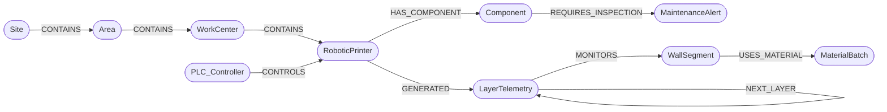

# Shared Graph Schema

GraphPrint-Twin owns this schema, and BioPrint-Guard writes into it. Both connect to the same Neo4j database, so equipment, telemetry, materials, building elements and maintenance alerts form one connected digital twin.

The model is aligned with three standards, each covering one area. [standards-alignment.md](standards-alignment.md) has the full mapping and the gaps.

- **ISA-95 / IEC 62264:** equipment hierarchy and material lots
- **Asset Administration Shell (IEC 63278):** asset identities
- **IFC / ISO 16739:** building elements

> If you change the schema, change this file first, then the code in both projects.

## Model



## Node labels

| Label | Key properties | Standard role | Written by |
|---|---|---|---|
| `Site` | `id`, `name`, `isa95_level` | ISA-95 Site | Twin (topology) |
| `Area` | `id`, `name`, `isa95_level` | ISA-95 Area | Twin (topology) |
| `WorkCenter` | `id`, `name`, `isa95_level`, `isa95_type` | ISA-95 Work Center (production line) | Twin (topology) |
| `PLC_Controller` | `id`, `ip` | Level 1–2 control system | Twin (topology) |
| `RoboticPrinter` | `id`, `type`, `isa95_level`, `aas_id` | ISA-95 Work Unit; AAS asset | Twin (topology) |
| `Component` | `id`, `name`, `axis`, `isa88_level`, `aas_id`, `last_alert_at` | ISA-88 Control Module; AAS asset | Twin (topology); Guard bootstraps if missing |
| `WallSegment` | `id`, `required_layers`, `ifc_guid`, `ifc_class`, `design_ref` | IFC `IfcWall` (by GlobalId) | Twin (topology) |
| `MaterialBatch` | `id`, `vendor`, `polymer`, `fibre_wt_pct`, `recycle_generation`, `moisture_ppm`, `isa95_class`, `material_definition` | ISA-95 Material Lot | Twin (topology) |
| `LayerTelemetry` | `id`, `layer_index`, `start_time`, `end_time`, `sample_period_s`, `n_samples`, `temp_mean/min/max/sd/cv_pct`, `pressure_mean/min/max/sd`, `anomaly_count`, `anomaly_offsets`, `status`, `raw_stored`, `raw_temps`, `raw_pressures` | Time-series bucket for one printed layer; AAS TimeSeries segment; ISA-95 segment response | Twin (ingestion) |
| `MaintenanceAlert` | `id`, `status`, `severity`, `peak_risk_score`, `source`, `created_at`, `updated_at`, `closed_at` | Maintenance request | Guard |

`LayerTelemetry.status` is `ANOMALY_WARNING` if any sample in the layer left the 235 °C / 48 bar envelope, otherwise `OPTIMAL`.
`MaintenanceAlert.status` is `OPEN` or `CLOSED`; `severity` is `HIGH` (score 0.85–0.94) or `CRITICAL` (≥ 0.95). While an alert is open its `peak_risk_score` and `severity` only go up. `Component.last_alert_at` is set by Guard each time it raises or updates an alert.

## Relationships

| Pattern | Meaning |
|---|---|
| `(:Site)-[:CONTAINS]->(:Area)-[:CONTAINS]->(:WorkCenter)-[:CONTAINS]->(:RoboticPrinter)` | ISA-95 role-based equipment hierarchy |
| `(:PLC_Controller)-[:CONTROLS]->(:RoboticPrinter)` | Which controller drives which printer |
| `(:RoboticPrinter)-[:HAS_COMPONENT]->(:Component)` | Physical parts of a printer |
| `(:RoboticPrinter)-[:GENERATED]->(:LayerTelemetry)` | Which printer produced the layer's telemetry |
| `(:LayerTelemetry)-[:MONITORS]->(:WallSegment)` | Which wall the layer belongs to |
| `(:LayerTelemetry)-[:NEXT_LAYER]->(:LayerTelemetry)` | Ordered chain of layers within a wall (a time chain you can walk) |
| `(:WallSegment)-[:USES_MATERIAL]->(:MaterialBatch)` | Material traceability |
| `(:Component)-[:REQUIRES_INSPECTION]->(:MaintenanceAlert)` | Open or historical maintenance alerts on a part |

## Telemetry storage: one bucket per printed layer

GraphPrint-Twin samples the PLC at 10 Hz, but it does **not** store one node per sample. One printer at 10 Hz produces 864,000 samples a day. As nodes, that is 864,000 nodes and 1.7 million relationships, which bloats the store and slows every traversal. The graph's strength is context, so telemetry is bucketed by the natural unit of 3D printing, **the layer**:

| | Per-sample nodes | Layer buckets (this design) |
|---|---|---|
| Nodes per printer per day (10 Hz, ~12 min layers) | ~864,000 | **~120** |
| Write transactions | one per sample | **one per layer** |
| Raw samples | always | **only for anomalous layers** (configurable `raw_policy`) |
| Timestamps | stored on every node | **implicit**: `start_time + offset × sample_period_s` |

Every layer bucket always carries summary statistics, the count and offsets of out-of-envelope samples, and its status. Raw value arrays are kept only where they're needed for forensic review (`raw_policy = "anomaly"`, the default; `"all"` and `"none"` are also available). A retention job drops raw arrays after N days but keeps every summary.

**Writes are idempotent.** Layer ids are deterministic (`Printer_01/Studio_Unit_BackWall/L0042`). The ingest `MERGE`s the bucket and every relationship, so a retried or replayed write updates the layer instead of duplicating nodes or edges.

**Production path.** For long raw history, the samples belong in a time-series database or plant historian (TimescaleDB, InfluxDB, PI). The graph would keep these summaries and anomaly events plus a pointer (`raw_uri`) to the exact time range. The schema leaves room for that property; this demo keeps everything in Neo4j so it runs with a single container.

## Constraints

Every label has a uniqueness constraint on `id`:

```cypher
CREATE CONSTRAINT site_id       IF NOT EXISTS FOR (n:Site)             REQUIRE n.id IS UNIQUE;
CREATE CONSTRAINT area_id       IF NOT EXISTS FOR (n:Area)             REQUIRE n.id IS UNIQUE;
CREATE CONSTRAINT workcenter_id IF NOT EXISTS FOR (n:WorkCenter)       REQUIRE n.id IS UNIQUE;
CREATE CONSTRAINT plc_id        IF NOT EXISTS FOR (n:PLC_Controller)   REQUIRE n.id IS UNIQUE;
CREATE CONSTRAINT printer_id    IF NOT EXISTS FOR (n:RoboticPrinter)   REQUIRE n.id IS UNIQUE;
CREATE CONSTRAINT component_id  IF NOT EXISTS FOR (n:Component)        REQUIRE n.id IS UNIQUE;
CREATE CONSTRAINT wall_id       IF NOT EXISTS FOR (n:WallSegment)      REQUIRE n.id IS UNIQUE;
CREATE CONSTRAINT batch_id      IF NOT EXISTS FOR (n:MaterialBatch)    REQUIRE n.id IS UNIQUE;
CREATE CONSTRAINT layer_id      IF NOT EXISTS FOR (n:LayerTelemetry)   REQUIRE n.id IS UNIQUE;
CREATE CONSTRAINT alert_id      IF NOT EXISTS FOR (n:MaintenanceAlert) REQUIRE n.id IS UNIQUE;
```

## Baseline topology

| Node | id | Properties |
|---|---|---|
| Site | `Site_KZN_01` | `name: "Durban print plant (simulated)"` |
| Area | `Area_PrintHall_A` | `name: "Print hall A"` |
| WorkCenter | `WC_Line_1` | `name: "Wall-panel line 1"`, `isa95_type: "ProductionLine"` |
| PLC_Controller | `PLC_01` | `ip: "192.168.10.21"` |
| RoboticPrinter | `Printer_01` | `type: "Gantry-3D"`, `aas_id: "urn:bioprint:aas:Printer_01"` |
| Component | `Printer_01/StepperMotor_X` | `name: "StepperMotor"`, `axis: "X"`, `aas_id: "urn:bioprint:aas:Printer_01/StepperMotor_X"` |
| WallSegment | `Studio_Unit_BackWall` | `required_layers: 160`, `ifc_class: "IfcWall"`, `ifc_guid`: deterministic 22-char GlobalId, `design_ref: "studio_unit_v3.ifc"` |
| MaterialBatch | `BATCH-rPETG-GF-001` | `vendor: "Simulated Polymers (Pty) Ltd"`, `polymer: "rPETG"`, `fibre_wt_pct: 15.0`, `recycle_generation: 1`, `moisture_ppm: 150`, `material_definition: "rPETG-GF15"` |

All topology writes use `MERGE`, so they are safe to run any number of times. The batch composition matches BioPrint-PID's calibration batch (`config/default.toml`, `[material]`).

## Key queries

**Forensic traceback**: every anomalous layer, with which samples went out of spec, the wall (and its IFC id) and the material it was printed from:

```cypher
MATCH (p:RoboticPrinter)-[:GENERATED]->(b:LayerTelemetry {status: "ANOMALY_WARNING"})
      -[:MONITORS]->(w:WallSegment)-[:USES_MATERIAL]->(m:MaterialBatch)
RETURN b.id AS layer_id, b.layer_index AS layer, toString(b.start_time) AS start_time,
       b.anomaly_count AS anomaly_samples, b.anomaly_offsets AS anomaly_offsets,
       b.temp_max AS temp_max, b.pressure_max AS pressure_max, b.raw_stored AS raw_stored,
       p.id AS printer, w.id AS wall_segment, w.ifc_guid AS wall_ifc_guid,
       m.id AS batch, m.vendor AS vendor, m.fibre_wt_pct AS fibre_wt_pct,
       m.recycle_generation AS recycle_generation
ORDER BY w.id, b.layer_index;
```

**Exact time of each out-of-spec sample**, from implicit timestamps:

```cypher
MATCH (b:LayerTelemetry {id: $layer_id})
UNWIND b.anomaly_offsets AS i
RETURN b.start_time + duration({milliseconds: toInteger(i * b.sample_period_s * 1000)}) AS at,
       CASE WHEN b.raw_stored THEN b.raw_temps[i] END AS temp,
       CASE WHEN b.raw_stored THEN b.raw_pressures[i] END AS pressure;
```

**Walk a wall layer by layer** (the time chain): find layers whose temperature spread drifted up compared with the layer before, a clinical-QC style trend check:

```cypher
MATCH (prev:LayerTelemetry)-[:NEXT_LAYER]->(b:LayerTelemetry)-[:MONITORS]->(w:WallSegment {id: $wall_id})
WHERE b.temp_sd > 1.5 * prev.temp_sd
RETURN b.layer_index AS layer, prev.temp_sd AS sd_before, b.temp_sd AS sd_now
ORDER BY layer;
```

**Materials question**: anomaly rate by recycle generation, to see whether reprocessed batches misbehave:

```cypher
MATCH (b:LayerTelemetry)-[:MONITORS]->(:WallSegment)-[:USES_MATERIAL]->(m:MaterialBatch)
RETURN m.recycle_generation AS generation,
       count(b) AS layers,
       sum(b.n_samples) AS samples,
       round(100.0 * sum(b.anomaly_count) / sum(b.n_samples), 3) AS anomaly_pct
ORDER BY generation;
```

**Operations question**: which walls did this printer work on while one of its components had an open alert? The answer is returned with IFC ids so it can be highlighted in a BIM viewer:

```cypher
MATCH (p:RoboticPrinter)-[:HAS_COMPONENT]->(c:Component)-[:REQUIRES_INSPECTION]->(a:MaintenanceAlert {status: "OPEN"})
MATCH (p)-[:GENERATED]->(b:LayerTelemetry)-[:MONITORS]->(w:WallSegment)
WHERE b.end_time >= a.created_at
RETURN c.id AS component, a.severity AS severity,
       collect(DISTINCT {wall: w.id, ifc_guid: w.ifc_guid}) AS walls_at_risk;
```

**ISA-95 roll-up**: telemetry health by production line:

```cypher
MATCH (wc:WorkCenter)-[:CONTAINS]->(p:RoboticPrinter)-[:GENERATED]->(b:LayerTelemetry)
RETURN wc.name AS line, p.id AS printer, count(b) AS layers, sum(b.n_samples) AS samples,
       sum(CASE b.status WHEN "ANOMALY_WARNING" THEN 1 ELSE 0 END) AS anomalous_layers;
```

**Raise or update a maintenance alert (Guard)**: idempotent, with at most one open alert per component. The `SET` on the component comes first so it takes the component's write lock, which stops two gateways from both seeing "no open alert" and creating two:

```cypher
MATCH (c:Component {id: $component_id})
SET c.last_alert_at = datetime()
WITH c
OPTIONAL MATCH (c)-[:REQUIRES_INSPECTION]->(open:MaintenanceAlert {status: "OPEN"})
WITH c, open ORDER BY open.created_at LIMIT 1
FOREACH (_ IN CASE WHEN open IS NULL THEN [1] ELSE [] END |
  CREATE (c)-[:REQUIRES_INSPECTION]->(:MaintenanceAlert {
    id: $alert_id, status: "OPEN", severity: $severity, peak_risk_score: $risk,
    source: $source, created_at: datetime(), updated_at: datetime()}))
FOREACH (_ IN CASE WHEN open IS NOT NULL AND $risk > open.peak_risk_score THEN [1] ELSE [] END |
  SET open.severity = $severity, open.peak_risk_score = $risk, open.updated_at = datetime())
WITH c, open IS NULL AS created
MATCH (c)-[:REQUIRES_INSPECTION]->(a:MaintenanceAlert {status: "OPEN"})
RETURN a.id AS id, a.severity AS severity, a.peak_risk_score AS peak_risk_score, created;
```

**Close an alert after the inspection (Guard)**: the alert stays in the graph as history:

```cypher
MATCH (:Component {id: $component_id})-[:REQUIRES_INSPECTION]->(a:MaintenanceAlert {status: "OPEN"})
SET a.status = "CLOSED", a.closed_at = datetime(), a.updated_at = datetime()
RETURN count(a) AS closed;
```
