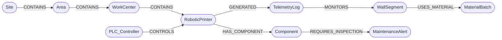

# Shared Graph Schema

GraphPrint-Twin owns this schema, and BioPrint-Guard writes into it. Both connect to the same Neo4j database, so equipment, telemetry, materials, building elements and maintenance alerts form one connected digital twin.

The model is aligned with three standards, each covering one area. [standards-alignment.md](standards-alignment.md) has the full mapping and the gaps.

- **ISA-95 / IEC 62264:** equipment hierarchy and material lots
- **Asset Administration Shell (IEC 63278):** asset identities
- **IFC / ISO 16739:** building elements

> If you change the schema, change this file first, then the code in both projects.

## Model



## Node labels

| Label | Key properties | Standard role | Written by |
|---|---|---|---|
| `Site` | `id`, `name`, `isa95_level` | ISA-95 Site | Twin (topology) |
| `Area` | `id`, `name`, `isa95_level` | ISA-95 Area | Twin (topology) |
| `WorkCenter` | `id`, `name`, `isa95_level`, `isa95_type` | ISA-95 Work Center (production line) | Twin (topology) |
| `PLC_Controller` | `id`, `ip` | Level 1–2 control system | Twin (topology) |
| `RoboticPrinter` | `id`, `type`, `isa95_level`, `aas_id` | ISA-95 Work Unit; AAS asset | Twin (topology) |
| `Component` | `id`, `name`, `axis`, `isa88_level`, `aas_id` | ISA-88 Control Module; AAS asset | Twin (topology); Guard bootstraps if missing |
| `WallSegment` | `id`, `required_layers`, `ifc_guid`, `ifc_class`, `design_ref` | IFC `IfcWall` (by GlobalId) | Twin (topology) |
| `MaterialBatch` | `id`, `vendor`, `polymer`, `fibre_wt_pct`, `recycle_generation`, `moisture_ppm`, `isa95_class`, `material_definition` | ISA-95 Material Lot | Twin (topology) |
| `TelemetryLog` | `id`, `timestamp`, `nozzle_temp`, `pump_pressure`, `status` | Time-series sample; AAS TimeSeries record | Twin (ingestion) |
| `MaintenanceAlert` | `id`, `status`, `severity`, `peak_risk_score`, `created_at`, `updated_at` | Maintenance request | Guard |

`TelemetryLog.status` is either `OPTIMAL` or `ANOMALY_WARNING`.
`MaintenanceAlert.status` is `OPEN` or `CLOSED`; `severity` is `HIGH` (score 0.85–0.94) or `CRITICAL` (≥ 0.95).

## Relationships

| Pattern | Meaning |
|---|---|
| `(:Site)-[:CONTAINS]->(:Area)-[:CONTAINS]->(:WorkCenter)-[:CONTAINS]->(:RoboticPrinter)` | ISA-95 role-based equipment hierarchy |
| `(:PLC_Controller)-[:CONTROLS]->(:RoboticPrinter)` | Which controller drives which printer |
| `(:RoboticPrinter)-[:HAS_COMPONENT]->(:Component)` | Physical parts of a printer |
| `(:RoboticPrinter)-[:GENERATED]->(:TelemetryLog)` | Which printer produced a reading |
| `(:TelemetryLog)-[:MONITORS]->(:WallSegment)` | What was being printed when the reading was taken |
| `(:WallSegment)-[:USES_MATERIAL]->(:MaterialBatch)` | Material traceability |
| `(:Component)-[:REQUIRES_INSPECTION]->(:MaintenanceAlert)` | Open or historical maintenance alerts on a part |

## Constraints

Every label has a uniqueness constraint on `id`:

```cypher
CREATE CONSTRAINT site_id       IF NOT EXISTS FOR (n:Site)             REQUIRE n.id IS UNIQUE;
CREATE CONSTRAINT area_id       IF NOT EXISTS FOR (n:Area)             REQUIRE n.id IS UNIQUE;
CREATE CONSTRAINT workcenter_id IF NOT EXISTS FOR (n:WorkCenter)       REQUIRE n.id IS UNIQUE;
CREATE CONSTRAINT plc_id        IF NOT EXISTS FOR (n:PLC_Controller)   REQUIRE n.id IS UNIQUE;
CREATE CONSTRAINT printer_id    IF NOT EXISTS FOR (n:RoboticPrinter)   REQUIRE n.id IS UNIQUE;
CREATE CONSTRAINT component_id  IF NOT EXISTS FOR (n:Component)        REQUIRE n.id IS UNIQUE;
CREATE CONSTRAINT wall_id       IF NOT EXISTS FOR (n:WallSegment)      REQUIRE n.id IS UNIQUE;
CREATE CONSTRAINT batch_id      IF NOT EXISTS FOR (n:MaterialBatch)    REQUIRE n.id IS UNIQUE;
CREATE CONSTRAINT log_id        IF NOT EXISTS FOR (n:TelemetryLog)     REQUIRE n.id IS UNIQUE;
CREATE CONSTRAINT alert_id      IF NOT EXISTS FOR (n:MaintenanceAlert) REQUIRE n.id IS UNIQUE;
```

## Baseline topology

| Node | id | Properties |
|---|---|---|
| Site | `Site_KZN_01` | `name: "Durban print plant (simulated)"` |
| Area | `Area_PrintHall_A` | `name: "Print hall A"` |
| WorkCenter | `WC_Line_1` | `name: "Wall-panel line 1"`, `isa95_type: "ProductionLine"` |
| PLC_Controller | `PLC_01` | `ip: "192.168.10.21"` |
| RoboticPrinter | `Printer_01` | `type: "Gantry-3D"`, `aas_id: "urn:bioprint:aas:Printer_01"` |
| Component | `Printer_01/StepperMotor_X` | `name: "StepperMotor"`, `axis: "X"`, `aas_id: "urn:bioprint:aas:Printer_01/StepperMotor_X"` |
| WallSegment | `Studio_Unit_BackWall` | `required_layers: 160`, `ifc_class: "IfcWall"`, `ifc_guid`: deterministic 22-char GlobalId, `design_ref: "studio_unit_v3.ifc"` |
| MaterialBatch | `BATCH-rPETG-GF-001` | `vendor: "Simulated Polymers (Pty) Ltd"`, `polymer: "rPETG"`, `fibre_wt_pct: 15.0`, `recycle_generation: 1`, `moisture_ppm: 150`, `material_definition: "rPETG-GF15"` |

All topology writes use `MERGE`, so they are safe to run any number of times. The batch composition matches BioPrint-PID's calibration batch (`config/default.toml`, `[material]`).

## Key queries

**Forensic traceback**: every anomalous reading, with the wall (and its IFC id) and the material it was printed from:

```cypher
MATCH (p:RoboticPrinter)-[:GENERATED]->(t:TelemetryLog {status: "ANOMALY_WARNING"})
      -[:MONITORS]->(w:WallSegment)-[:USES_MATERIAL]->(m:MaterialBatch)
RETURN t.timestamp AS timestamp, t.nozzle_temp AS nozzle_temp, t.pump_pressure AS pump_pressure,
       p.id AS printer, w.id AS wall_segment, w.ifc_guid AS wall_ifc_guid,
       m.id AS batch, m.vendor AS vendor, m.fibre_wt_pct AS fibre_wt_pct,
       m.recycle_generation AS recycle_generation
ORDER BY t.timestamp;
```

**Materials question**: anomaly rate by recycle generation, to see whether reprocessed batches misbehave:

```cypher
MATCH (t:TelemetryLog)-[:MONITORS]->(:WallSegment)-[:USES_MATERIAL]->(m:MaterialBatch)
RETURN m.recycle_generation AS generation,
       count(t) AS readings,
       round(100.0 * sum(CASE t.status WHEN "ANOMALY_WARNING" THEN 1 ELSE 0 END) / count(t), 1)
         AS anomaly_pct
ORDER BY generation;
```

**Operations question**: which walls did this printer work on while one of its components had an open alert? The answer is returned with IFC ids so it can be highlighted in a BIM viewer:

```cypher
MATCH (p:RoboticPrinter)-[:HAS_COMPONENT]->(c:Component)-[:REQUIRES_INSPECTION]->(a:MaintenanceAlert {status: "OPEN"})
MATCH (p)-[:GENERATED]->(t:TelemetryLog)-[:MONITORS]->(w:WallSegment)
WHERE t.timestamp >= a.created_at
RETURN c.id AS component, a.severity AS severity,
       collect(DISTINCT {wall: w.id, ifc_guid: w.ifc_guid}) AS walls_at_risk;
```

**ISA-95 roll-up**: telemetry health by production line:

```cypher
MATCH (wc:WorkCenter)-[:CONTAINS]->(p:RoboticPrinter)-[:GENERATED]->(t:TelemetryLog)
RETURN wc.name AS line, p.id AS printer, count(t) AS readings,
       sum(CASE t.status WHEN "ANOMALY_WARNING" THEN 1 ELSE 0 END) AS anomalies;
```

**Raise or update a maintenance alert (Guard)**: idempotent, with at most one open alert per component:

```cypher
MATCH (c:Component {id: $component_id})
OPTIONAL MATCH (c)-[:REQUIRES_INSPECTION]->(open:MaintenanceAlert {status: "OPEN"})
FOREACH (_ IN CASE WHEN open IS NULL THEN [1] ELSE [] END |
  CREATE (c)-[:REQUIRES_INSPECTION]->(:MaintenanceAlert {
    id: $alert_id, status: "OPEN", severity: $severity,
    peak_risk_score: $risk, created_at: datetime(), updated_at: datetime()}))
FOREACH (_ IN CASE WHEN open IS NOT NULL THEN [1] ELSE [] END |
  SET open.peak_risk_score = CASE WHEN $risk > open.peak_risk_score THEN $risk ELSE open.peak_risk_score END,
      open.severity = $severity,
      open.updated_at = datetime());
```
