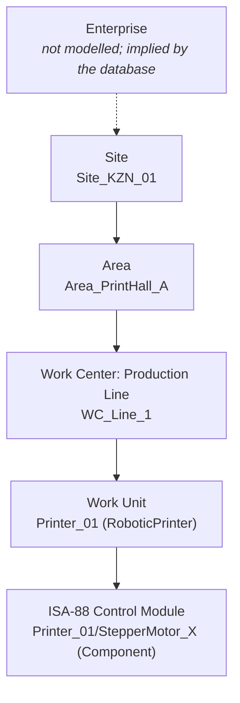

# Standards Alignment: ISA-95, AAS, IFC, OPC UA, IEC 61131-3

This page is written for industrial digital twin architects, BIM and construction technologists, and controls engineers. It shows where the suite follows an industry standard, how closely, and where it deliberately stops short. "Aligned" here means the concepts and identifiers map cleanly. It does **not** mean the repo is certified against, or a complete implementation of, any standard.

| Standard | Scope here | Status |
|---|---|---|
| ISA-95 / IEC 62264 | Equipment hierarchy, material lots | **Modelled** in the graph (labels + properties) |
| ISA-88 / IEC 61512 | Control module below the work unit | **Labelled** (`isa88_level` on `Component`) |
| Asset Administration Shell / IEC 63278 | Asset identity, submodel mapping | **Identifiers** in the graph; submodel mapping documented, no AAS server |
| IFC / ISO 16739 | Link printed walls to BIM elements | **GlobalId** on `WallSegment`; IFC export documented, not built |
| OPC UA / IEC 62541 | Machine data access (BioPrint-Guard) | Custom information model; companion-spec mapping documented |
| IEC 61131-3 | PLC implementation of control and QC | **Ported** to Structured Text, logic-verified by the test suite |

---

## ISA-95 (IEC 62264): equipment and material

ISA-95 defines a role-based equipment hierarchy and a material model so that MES and ERP systems agree on what "a line" or "a lot" is. The graph mirrors both.

| ISA-95 concept | Graph | Notes |
|---|---|---|
| Site, Area | `:Site`, `:Area` with `isa95_level` | `CONTAINS` relationships, as in the B2MML equipment model |
| Work Center (Production Line) | `:WorkCenter {isa95_type: "ProductionLine"}` | Other work-center types (Process Cell, Storage Zone) fit the same label |
| Work Unit | `:RoboticPrinter {isa95_level: "WorkUnit"}` | |
| Equipment / control modules | `:Component {isa88_level: "ControlModule"}` | ISA-88 terminology below the work unit |
| Material Definition | `MaterialBatch.material_definition` (e.g. `rPETG-GF15`) | Currently a property; could become its own `:MaterialDefinition` node |
| Material Lot | `:MaterialBatch {isa95_class: "MaterialLot"}` | Carries lot properties such as fibre loading, recycle generation and moisture |
| Production performance / segment response | `LayerTelemetry` (one per printed layer) linked to `WallSegment` | A layer bucket is effectively a segment response with process data; no explicit job order objects yet |

**Gaps a reviewer should know about:** there are no Personnel, Physical Asset (as distinct from Equipment) or Process Segment models, and no B2MML import/export. A natural next step is a `:JobOrder` node between `WorkCenter` and `WallSegment`.

## Asset Administration Shell (IEC 63278)

The AAS is the Industrie 4.0 digital representation of an asset: a shell with a globally unique id holding standardised **submodels**. Each `RoboticPrinter` and `Component` carries an `aas_id` (a URN), so a shell can be created for it without changing the graph.

| AAS submodel (IDTA template) | Where the data lives today |
|---|---|
| Digital Nameplate | `RoboticPrinter.type`, `Component.name` / `axis` (minimal) |
| Technical Data | BioPrint-PID `config/default.toml` (heater power, thermal mass, rheology) |
| Time Series Data | `LayerTelemetry` buckets: one segment per layer with summary statistics, raw values only for anomalous layers, implicit timestamps |
| Maintenance / condition monitoring | `MaintenanceAlert` via `REQUIRES_INSPECTION` (BioPrint-Guard) |
| Bill of Material (hierarchical structures) | `HAS_COMPONENT`, `CONTAINS` |

**Not built:** an AAS server (e.g. Eclipse BaSyx), AASX packaging, or submodel JSON serialisation. The `aas_id` URNs are placeholders in the `urn:bioprint:aas:` namespace; a real deployment would use IRIs it controls.

## IFC (ISO 16739): printed walls in BIM

Construction project managers work in BIM models, not graph databases. Each `WallSegment` stores:

- `ifc_guid`: a valid 22-character IFC GlobalId, generated deterministically from the wall's id (`projects/01_graphprint_twin/src/ifc.py`, the same compression algorithm IfcOpenShell uses; tested by round-trip).
- `ifc_class`: `IfcWall`
- `design_ref`: the source IFC file

That GlobalId is the join key. A BIM tool can colour walls by QC outcome, and the graph can answer questions like "show me every wall printed during an open maintenance alert" (see [graph-schema.md](graph-schema.md#key-queries)).

**Proposed IFC export (not built):** attach a custom property set to each `IfcWall`:

| Pset_BioPrintQuality property | Source |
|---|---|
| `PrintedBy` | `RoboticPrinter.id` |
| `MaterialLot` | `MaterialBatch.id` |
| `FibreLoading_wt` / `RecycleGeneration` | `MaterialBatch` |
| `AnomalyCount` | count of `ANOMALY_WARNING` logs that `MONITORS` the wall |
| `PrintedDuringOpenAlert` | the cross-project query in graph-schema.md |

With IfcOpenShell this is a short script: open the design IFC, look up each wall with `by_guid(ifc_guid)`, and add the property set.

## OPC UA (IEC 62541): BioPrint-Guard's information model

BioPrint-Guard exposes `Objects/FactoryFloor/ExtrusionGantry/StepperMotor` with `motor_current`, `housing_temp` and `vibration_frequency` in a custom namespace. That keeps the demo small, but it is **not** a companion-spec model. The mapping a production system would use:

| Companion spec | What it would standardise |
|---|---|
| OPC 40001-1 Machinery (Basic Building Blocks) | Machine identification, MachineryItemState, component hierarchy |
| OPC 40010-1 Robotics | Motion device, axes, drives and their parameters |
| OPC 10000-9 Alarms & Conditions | Raising maintenance conditions natively in OPC UA as well as in the graph |

Questions for reviewers on this and on multi-robot scaling are in [reviewers.md](reviewers.md#industrial-digital-twin-architect).

## IEC 61131-3: controller implementation

The PID and Westgard logic exist as Structured Text function blocks (`projects/02_bioprint_pid/plc/`). They are logic-verified by the test suite against the Python reference by replaying 300 scans; compile and target validation in TwinCAT or CODESYS is open. See the [PLC README](../projects/02_bioprint_pid/plc/README.md).
