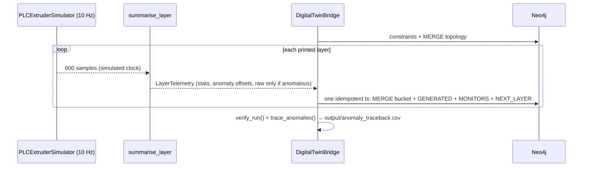

# 🏗️ GraphPrint-Twin

**Semantic cyber-physical digital twin on Neo4j.**

I sample simulated PLC telemetry (nozzle temperature and pump pressure) from a polymer extruder at 10 Hz and stream it into Neo4j, **one node per printed layer**. Each `LayerTelemetry` bucket is attached to the printer that produced it and the wall it belongs to, and is chained to the layer before it. Walls link to their material batch, so one Cypher query traces an out-of-spec layer back to the batch, the vendor and the exact samples that went out of spec.

This project owns the suite's [shared graph schema](../../docs/graph-schema.md). BioPrint-Guard writes maintenance alerts into the same graph.

The schema follows the **ISA-95** equipment hierarchy (Site → Area → WorkCenter → printer), gives assets **Asset Administration Shell** ids, records the **materials science** of each batch (fibre loading, recycle generation, moisture), and stores an **IFC GlobalId** on every printed wall so QC results can be joined to the BIM model. Mapping and gaps: [standards-alignment.md](../../docs/standards-alignment.md).

> Simulated data only. No PLC hardware is involved.

## Why layer buckets, not one node per reading

A graph database is good at *context*: which machine, which wall, which batch. It isn't built to hold long numeric series. Stored naively, one printer at 10 Hz would add **864,000 nodes and 1.7 million relationships a day**. So the edge gateway buffers each layer's samples and writes one bucket:

| | Per-sample nodes | Layer buckets |
|---|---|---|
| Nodes per printer per day (~12 min layers) | ~864,000 | **~120** |
| Graph writes | one per sample | **one transaction per layer** |
| Raw samples kept | all | **anomalous layers only** (`--raw-policy anomaly`, default) |
| Timestamps | on every node | **implicit**: `start_time + offset × 0.1 s` |

Every bucket always holds summary statistics (mean, min, max, SD, CV%), the count and offsets of out-of-envelope samples, and a status, so trends and traceback work without raw data. For long raw history in production, the samples belong in a time-series store or historian, with the graph keeping summaries, events and a pointer to the raw range ([graph-schema.md](../../docs/graph-schema.md#telemetry-storage-one-bucket-per-printed-layer)).

## How it works



- **Simulator:** a mean-reverting random walk around 230 °C and 45 bar at 10 Hz (stationary SD ≈ 1.1 °C), with rare one-sample process upsets. Samples above 235 °C or 48 bar are tagged `ANOMALY_WARNING`, the way a lab flags a QC result outside limits. A simulated clock keeps runs reproducible and lets them be time-compressed.
- **Aggregator** (`layer_aggregator.py`): turns a layer's samples into a bucket with a deterministic id (`Printer_01/Studio_Unit_BackWall/L0042`).
- **Bridge:** each layer is one parameterised, **idempotent** managed transaction. It `MATCH`es the printer and wall first, so a bucket can never be stored unattached (`TopologyMissingError` otherwise), then `MERGE`s the bucket and every relationship, so a retried write updates rather than duplicates.
- **Standards hooks:** `ifc.py` generates valid 22-character IFC GlobalIds using the compression algorithm IfcOpenShell uses, tested by round-trip and known vectors. Printers and components carry `aas_id` URNs.
- **Swappable source:** the loop depends only on a `TelemetrySource` protocol, so a Modbus TCP, OPC UA or Kafka reader can replace the simulator without changing the graph code.

## Run it

```bash
# from the repo root
docker compose up -d neo4j

cd projects/01_graphprint_twin
pip install -r requirements-dev.txt
python src/main.py                               # 10 layers × 600 samples, 1 s between layers
python src/main.py --layers 160 --interval 0     # a whole 160-layer wall, as fast as possible
python src/main.py --raw-policy all              # keep raw arrays on every layer
python src/main.py --prune-days 30               # drop raw arrays older than 30 days
```

600 samples per layer is 60 s of 10 Hz data, compressed for a quick demo. A real LFAM layer takes ~10–16 min (~6,000–9,600 samples), which makes the saving from bucketing larger still.

Configuration is read from environment variables: `NEO4J_URI` (default `bolt://localhost:7687`), `NEO4J_USER`, `NEO4J_PASSWORD` and `NEO4J_DATABASE`. Leave the user unset for a no-auth instance.

Open http://localhost:7474 and walk a wall layer by layer:

```cypher
MATCH path = (:WorkCenter)-[:CONTAINS]->(:RoboticPrinter)-[:GENERATED]->(:LayerTelemetry)
             -[:MONITORS]->(:WallSegment)-[:USES_MATERIAL]->(:MaterialBatch)
RETURN path LIMIT 25;

MATCH chain = (:LayerTelemetry {layer_index: 0})-[:NEXT_LAYER*]->(:LayerTelemetry)
RETURN chain ORDER BY length(chain) DESC LIMIT 1;
```

More queries (exact time of each out-of-spec sample, SD-drift between layers, anomaly rate by recycle generation, walls printed during an open maintenance alert) are in [graph-schema.md](../../docs/graph-schema.md#key-queries).

## Tests

```bash
python -m pytest                                   # unit tests; integration tests are skipped
NEO4J_URI=bolt://localhost:7687 python -m pytest   # adds live-graph integration tests
```

## Requirements map

| PRD requirement | Where | Checked by |
|---|---|---|
| **FR-1** Telemetry synthesis and classification (10 Hz) | `src/plc_simulator.py` | `tests/test_plc_simulator.py` |
| **FR-2** Graph instantiation, no unattached telemetry | `initialize_factory_topology`, `LAYER_INGEST_QUERY` | `test_topology_is_idempotent`, `verify_run` in `main.py` |
| **FR-3** Parameterised, transactional, idempotent ingestion | `ingest_layer` (`execute_write`) | `tests/test_database.py`, `test_reingest_updates_instead_of_duplicating` |
| **FR-4** Forensic traceback to material batch | `TRACEBACK_QUERY`, `trace_anomalies()` | `test_layers_are_linked_chained_and_traceable` |
| Layer bucketing (addendum v1.2) | `src/layer_aggregator.py` | `tests/test_layer_aggregator.py`, `test_raw_arrays_only_on_anomalous_layers` |
| ISA-95 / AAS / IFC alignment | `TOPOLOGY_QUERY`, `src/ifc.py` | `test_isa95_hierarchy_and_standards_ids`, `tests/test_ifc.py` |
| NFR 5.1 Constraints and retention | `CONSTRAINTS`, `prune_raw_arrays()` (`--prune-days`) | — |
| NFR 5.2 < 250 ms per write | Per-layer write latency logged, with a warning above budget | Run log |
| NFR 5.3 Swappable data source | `TelemetrySource` protocol | `test_main_loop_writes_one_bucket_per_layer` |

## Files

```text
src/
├── plc_simulator.py     TelemetryReading, TelemetrySource, PLCExtruderSimulator (10 Hz)
├── layer_aggregator.py  LayerTelemetry bucket, summarise_layer, raw policy
├── database.py          DigitalTwinBridge and all Cypher
├── ifc.py               IFC GlobalId compress / expand
└── main.py              CLI entry point and run verification
tests/
├── test_plc_simulator.py
├── test_layer_aggregator.py
├── test_database.py     fake-driver unit tests + main-loop smoke test
├── test_ifc.py
└── test_integration.py  live Neo4j (needs NEO4J_URI)
```
