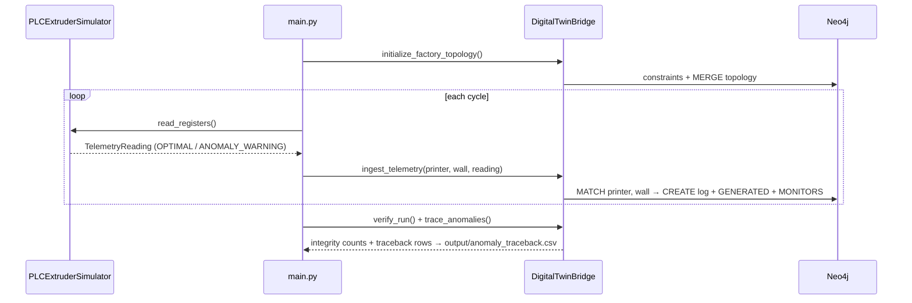

# 🏗️ GraphPrint-Twin

**Semantic cyber-physical digital twin on Neo4j.**

I stream simulated PLC telemetry (nozzle temperature and pump pressure) from a polymer extruder into Neo4j. Every reading becomes a `TelemetryLog` node attached to the printer that generated it and the wall segment it was printing. Wall segments link to their material batch, so one Cypher query traces an out-of-spec reading back to the batch and vendor.

This project owns the suite's [shared graph schema](../../docs/graph-schema.md). BioPrint-Guard writes maintenance alerts into the same graph.

The schema follows the **ISA-95** equipment hierarchy (Site → Area → WorkCenter → printer), gives assets **Asset Administration Shell** ids, records the **materials science** of each batch (fibre loading, recycle generation, moisture), and stores an **IFC GlobalId** on every printed wall so QC results can be joined to the BIM model. Mapping and gaps: [standards-alignment.md](../../docs/standards-alignment.md).

> Simulated data only. No PLC hardware is involved.

## How it works



- **Simulator:** a mean-reverting random walk around 230 °C and 45 bar, with occasional one-reading process upsets. Readings above 235 °C or 48 bar are tagged `ANOMALY_WARNING`, the way a lab flags a QC result outside limits. The default seed (42) is reproducible.
- **Bridge:** every write is a parameterised managed transaction. The ingest query `MATCH`es the printer and wall before creating anything, so a reading can never be stored unattached; if the topology is missing it raises `TopologyMissingError`.
- **Standards hooks:** `ifc.py` generates valid 22-character IFC GlobalIds using the compression algorithm IfcOpenShell uses, tested by round-trip and known vectors. Printers and components carry `aas_id` URNs.
- **Swappable source:** the loop depends only on a `TelemetrySource` protocol, so a Modbus TCP, OPC UA or Kafka reader can replace the simulator without changing the graph code.

## Run it

```bash
# from the repo root
docker compose up -d neo4j

cd projects/01_graphprint_twin
pip install -r requirements-dev.txt
python src/main.py                 # 10 cycles, 1 s apart
python src/main.py --cycles 120    # 2-minute soak
python src/main.py --interval 0    # as fast as possible
```

Configuration is read from environment variables: `NEO4J_URI` (default `bolt://localhost:7687`), `NEO4J_USER`, `NEO4J_PASSWORD` and `NEO4J_DATABASE`. Leave the user unset for a no-auth instance.

Example output (the readings come from the default seed; timings will vary):

```text
✓ cycle  1/10  temp=229.83 °C  pressure=44.90 bar  OPTIMAL            6.1 ms
...
⚠ cycle  9/10  temp=235.48 °C  pressure=48.27 bar  ANOMALY_WARNING    4.8 ms
✓ cycle 10/10  temp=229.03 °C  pressure=43.97 bar  OPTIMAL            4.5 ms
Integrity: {'expected': 10, 'found': 10, 'linked': 10}
Traceback: 1 anomalous readings -> batches ['BATCH-rPETG-GF-001'] (saved to output/anomaly_traceback.csv)
PASS: 10 readings ingested and fully linked
```

Open http://localhost:7474 and run:

```cypher
MATCH path = (:PLC_Controller)-[:CONTROLS]->(:RoboticPrinter)-[:GENERATED]->(:TelemetryLog)
             -[:MONITORS]->(:WallSegment)-[:USES_MATERIAL]->(:MaterialBatch)
RETURN path LIMIT 25
```

## Tests

```bash
python -m pytest                       # unit tests; integration tests are skipped
NEO4J_URI=bolt://localhost:7687 python -m pytest   # adds live-graph integration tests
```

## Requirements map

| PRD requirement | Where | Checked by |
|---|---|---|
| **FR-1** Telemetry synthesis and classification | `src/plc_simulator.py` | `tests/test_plc_simulator.py` |
| **FR-2** Graph instantiation, no unattached readings | `DigitalTwinBridge.initialize_factory_topology`, `INGEST_QUERY` | `test_topology_is_idempotent`, `verify_run` in `main.py` |
| **FR-3** Parameterised, transactional ingestion | `DigitalTwinBridge.ingest_telemetry` (`execute_write`) | `tests/test_database.py`, CI 10-cycle run |
| **FR-4** Forensic traceback to material batch | `TRACEBACK_QUERY`, `trace_anomalies()` | `test_ingested_readings_are_linked_and_traceable` |
| ISA-95 / AAS / IFC alignment | `TOPOLOGY_QUERY`, `src/ifc.py` | `test_isa95_hierarchy_and_standards_ids`, `tests/test_ifc.py` |
| NFR 5.1 Constraints and retention | `CONSTRAINTS`, `prune_optimal_logs()` (`--prune-days`) | — |
| NFR 5.2 < 250 ms per write | Per-cycle latency logging, with a warning above budget | CI log |
| NFR 5.3 Swappable data source | `TelemetrySource` protocol | — |

## Files

```text
src/
├── plc_simulator.py   TelemetryReading, TelemetrySource, PLCExtruderSimulator
├── database.py        DigitalTwinBridge and all Cypher
├── ifc.py             IFC GlobalId compress / expand
└── main.py            CLI entry point and run verification
tests/
├── test_plc_simulator.py
├── test_database.py   fake-driver unit tests
├── test_ifc.py
└── test_integration.py  live Neo4j (needs NEO4J_URI)
```
