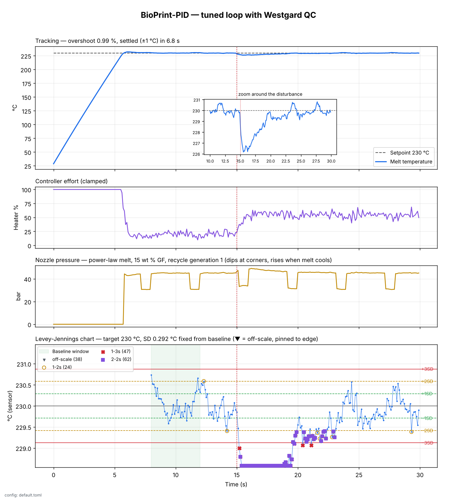
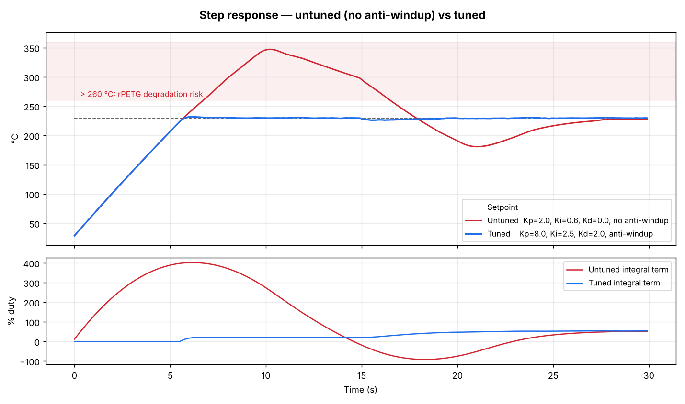
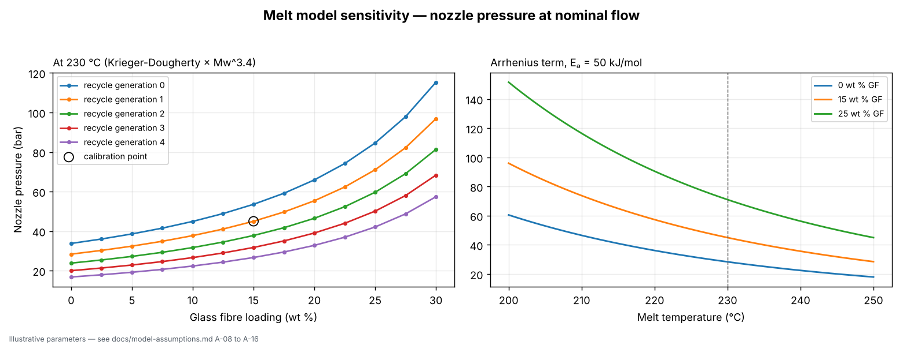
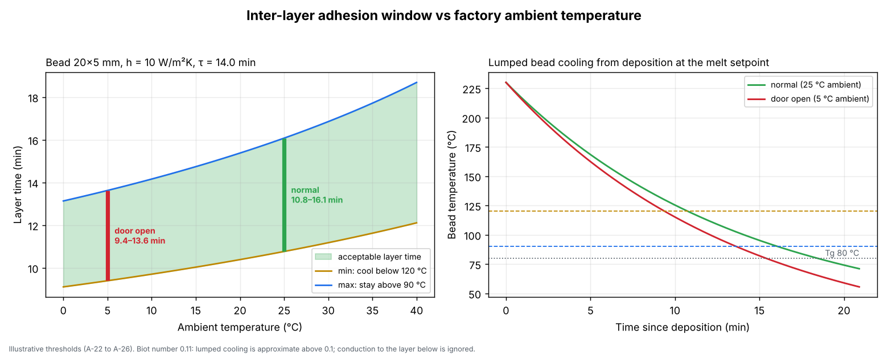

# 🧪 BioPrint-PID

**Precision polymer extrusion control, checked the way a clinical lab checks its controls.**

A discrete PID controller holds an extruder barrel at 230 °C while recycled, glass-fibre-reinforced PETG feeds through it. Around the loop I put the quality-control discipline I used for years in clinical pathology: a Westgard monitor fixes its limits from a stable baseline, then judges every reading against 1-2s, 1-3s and 2-2s rules. When the environment changes, the QC layer flags it within 0.2 s, while the controller is still recovering.

> Simulated plant. Every parameter is an illustrative value listed with its basis in the [assumptions register](../../docs/model-assumptions.md). Domain experts: see the [reviewer guide](../../docs/reviewers.md).



## What's in the model

| Piece | Model |
|---|---|
| **Controller** (`pid_controller.py`) | Parallel PID at dt = 0.1 s. Derivative on measurement (no setpoint kick), filtered derivative (N = 10), output clamped to 0–100 % duty, anti-windup by conditional integration. |
| **Barrel thermal mass** (`extruder_physics.py`) | `C·dT/dt = P_max·u − h·(T − T_amb) − ṁ·c_p·(T − T_feed)`: heater input against ambient loss and the cooling load of cold pellets. |
| **Melt rheology** | Power-law, shear-thinning (n = 0.4) with Arrhenius temperature dependence: `ΔP ∝ K(T)·Qⁿ`, calibrated to 45 bar at 230 °C. |
| **Composition** | Fibre loading via Krieger-Dougherty (wt % → volume fraction); recycling via Mw loss per pass and `η ∝ Mw^3.4`. Both are applied relative to the calibration batch. |
| **Gantry coupling** | The gantry slows to 40 % at corners every 4 s; auger flow follows it, so pressure and thermal load both change. |
| **Cold-extrusion interlock** | The auger stays off until the barrel first reaches melt temperature. |
| **Sensor** | Thermocouple with a 0.5 s lag and 0.15 °C noise. Both the controller and QC see only this signal. |
| **QC** (`westgard_validator.py`) | Baseline of 40 samples (8–12 s), after which the SD is frozen. Rules: 1-2s (warn), 1-3s (reject), 2-2s (reject). Rolling mean, SD and CV% are also reported. |
| **Layer time** (`layer_thermal.py`) | Lumped bead cooling gives the inter-layer adhesion window (earliest time the bead can support the next layer, latest time it can still bond) against factory ambient temperature. |

**Scenario:** a 30 s run (300 steps) from a 25 °C cold start. At step 150 a roller door opens, ambient drops to 5 °C and convective loss rises from 8 to 30 W/K.

## Results (default config, seed 42)

| Check | Target (PRD) | Result |
|---|---|---|
| FR-1 Overshoot | < 5 % | **0.99 %** |
| FR-1 Settling (±1 °C) | < 15 s | **6.8 s** |
| FR-1 Output bounds | 0–100 % | ✅ |
| FR-2 Pressure after a 15 °C drop | rises | **45.0 → 65.0 bar (×1.44)** |
| FR-3 Disturbance detected | yes | **First reject at 15.2 s (0.2 s after onset), rules 1-3s and 2-2s** |
| FR-3 Rejects during stable running | none | **0** |
| FR-4 Dashboard + CSV | written | ✅ |

### Robustness across 50 noise seeds
- FR-1 holds for every seed: worst overshoot 1.12 %, worst settling 11.9 s.
- The disturbance is detected in **50 of 50** runs.
- **5 of 50** runs (10 %) show one false reject in the 3 s stable window before the disturbance. That rate is what the maths predicts: checking every 10 Hz sample against 1-3s and 2-2s carries about a 0.3 % false-reject chance per sample, and over 30 samples that adds up to roughly 10 %. A lab avoids this by running controls once per batch rather than continuously, so a next step here would be to evaluate QC on a slower "control sample" schedule. The test suite bounds the false-reject rate at 15 % or below.

### Why anti-windup matters



Without anti-windup, the integrator keeps growing for the whole 5.5 s warm-up while the heater is pinned at 100 %. That stored error drives the barrel to about 347 °C (57 % overshoot), well into the range where the polymer would degrade. With conditional integration, the integral stays near zero until the loop leaves saturation.

### Material sensitivity



Nozzle pressure at the setpoint and nominal flow, against glass-fibre loading for recycle generations 0–4 (left) and against melt temperature (right). Doubling the fibre loading from 15 to 30 wt % roughly doubles the pressure. Each extra recycle pass lowers it by about 16 %, because chain scission shortens the polymer.

### Layer-time window



With the default thresholds (support below 120 °C, bond above 90 °C) and a 20 × 5 mm bead in still air, the next layer should be laid **10.8–16.1 min** after the last one at 25 °C. When the door opens and ambient drops to 5 °C, the window narrows and moves earlier to **9.4–13.6 min**. Layer fans (h = 25 W/m²K) cut it to **4.3–6.4 min** at 25 °C. These thresholds are the weakest assumptions in the model (A-26) and the first thing I'd ask an LFAM engineer to replace.

## Run it

```bash
cd projects/02_bioprint_pid
pip install -r requirements-dev.txt
python src/app.py                                   # about 1 s
python src/app.py --realtime                        # paced to the wall clock, 30 s
python src/app.py --config my_values.toml           # your parameters merged over the defaults
python src/app.py --config my_values.toml --report-only   # explore; always exit 0
python -m pytest                                    # 70 tests
```

Outputs land in `output/`: `pid_step_response.png`, `pid_tuning_comparison.png`, `material_sensitivity.png`, `layer_time_window.png`, `pid_run.csv` (every signal, every step), `material_sensitivity.csv`, `qc_violations.csv` and `acceptance.json` (PRD checks, config source, layer window). The exit code is 0 only if FR-1 to FR-4 all pass, unless `--report-only` is given.

### Configuration

All parameters live in [`config/default.toml`](config/default.toml), with units and `[A-xx]` tags that link to the [assumptions register](../../docs/model-assumptions.md). An override file only needs the keys it changes:

```toml
# my_machine.toml
[thermal]
heater_power_max = 24000.0
nominal_mass_flow = 0.011     # 40 kg/h

[layer]
bond_min_temp = 95.0
support_max_temp = 130.0
```

Unknown keys, misspellings and physically impossible values (e.g. a fibre loading past the packing limit) are rejected with a clear message. See [`config/examples/`](config/examples/) for a worked example, which `scripts/verify.sh` also runs.

### PLC port

The PID and Westgard blocks are also implemented in IEC 61131-3 Structured Text for TwinCAT and CODESYS, with TcUnit tests and reference vectors. See [`plc/README.md`](plc/README.md).

## Requirements map

| PRD requirement | Where | Checked by |
|---|---|---|
| **FR-1** Discrete PID, dt = 0.1 s, anti-windup | `pid_controller.py`, `plc/src/FB_BioPrintPID.st` | `test_pid_controller.py`, `test_fr1_holds_for_every_seed`, `test_plc_port.py` |
| **FR-2** Temperature-, flow- and composition-dependent melt, gantry coupling | `extruder_physics.py` | `test_extruder_physics.py`, `test_disturbance_raises_pressure` |
| **FR-3** Westgard 1-2s / 1-3s / 2-2s with rolling mean, SD and CV% | `westgard_validator.py`, `plc/src/FB_WestgardMonitor.st` | `test_westgard_validator.py`, `test_fr3_detection_and_false_rejection_rate`, `test_plc_port.py` |
| **FR-4** Dashboard and time-series export | `app.py` | `test_main_writes_outputs`, files in `output/` |
| Reviewer-adjustable parameters | `config/default.toml`, `config.py` | `test_config.py`, `test_example_configs_load_and_run` |
| Layer-time window | `layer_thermal.py` | `test_layer_thermal.py` |
| NFR 5.1 Deterministic timing | Simulated time by default; `--realtime` uses absolute monotonic ticks | — |
| NFR 5.2 Numerical stability | Clamps on duty, integral, temperature, pressure and the Arrhenius exponent | `test_output_always_finite`, `test_signals_are_finite` |

## Tuning notes

I chose Kp = 8, Ki = 2.5 s⁻¹, Kd = 2 s from a grid sweep against the model, balancing overshoot, settling after the auger interlock adds feed load, and recovery from the disturbance. The untuned comparison (Kp = 2, Ki = 0.6, no D, no anti-windup) is a deliberately naive configuration. Because the plant parameters are placeholders, these gains won't transfer to a real machine. With a measured step response, the next step would be an IMC or SIMC tuning rule.
