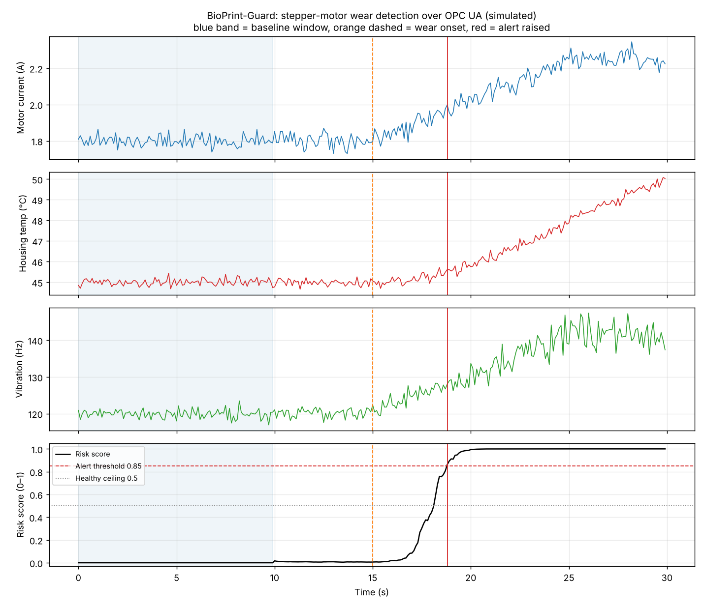
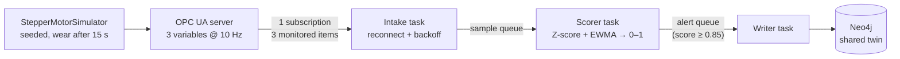

# 🛡️ BioPrint-Guard

**Async OPC UA predictive maintenance, with limits fixed the way a clinical lab fixes them.**

A simulated OPC UA server publishes a gantry stepper motor's current, housing temperature and vibration at 10 Hz. An async gateway subscribes to all three, scores each reading from 0 to 1, and raises a maintenance alert in the same Neo4j twin that [GraphPrint-Twin](../01_graphprint_twin) writes to, before the motor reaches full wear.

> Simulated motor. The operating point, noise and fault response are placeholder values chosen to make the scenario readable; none comes from a real drive. Questions for reviewers on multi-robot scaling and OPC UA companion specs are in the [reviewer guide](../../docs/reviewers.md).



## How it works



| Piece | What it does |
|---|---|
| **Motor model** (`motor_model.py`) | Seeded, simulated clock. Healthy signals are stationary with Gaussian noise. After 15 s a wear level ramps from 0 to 1 over 10 s: current and vibration frequency rise with it, vibration gets noisier, and housing temperature follows with a 12 s thermal lag. |
| **OPC UA server** (`opcua_server.py`) | `Objects/FactoryFloor/ExtrusionGantry/StepperMotor` with `motor_current`, `housing_temp` and `vibration_frequency` in the `urn:bioprint:guard` namespace. The three values of one reading share a source timestamp. |
| **Detector** (`anomaly_detector.py`) | The first 100 readings (10 s) fix each signal's mean and SD, which are then **frozen**. Each later reading becomes three Z-scores, combined into one distance and smoothed with an EWMA (α = 0.15). A logistic curve maps that to a 0–1 risk score. |
| **Gateway** (`gateway.py`) | Three `asyncio` tasks joined by queues. One subscription carries all three variables; readings are reassembled by source timestamp. A lost session is retried with exponential backoff (0.5 s doubling to 10 s). |
| **Alert store** (`alert_store.py`) | Parameterised Cypher in managed transactions. At most one `OPEN` `MaintenanceAlert` per component: the first crossing creates it and later scores only raise its peak and severity. |

**Why the baseline is frozen.** A lab sets control limits from a stable run of its control material and then judges new results against them. If the limits kept adapting, a slow drift would become the new normal and never be flagged. Wear is exactly that kind of slow drift, so the detector learns the healthy motor once and then holds its limits. The cost is that a legitimate change (a new motor, a different duty cycle) needs a new baseline; re-baselining is not automated yet.

**Why EWMA.** One noisy reading should not page a maintenance planner. The EWMA responds to a sustained shift within a couple of seconds and ignores a single spike, which the test suite checks directly.

## Results (seed 42)

| Check | Target (PRD) | Result |
|---|---|---|
| FR-1 Address space | FactoryFloor → ExtrusionGantry → StepperMotor | ✅ three Double variables |
| FR-2 Subscription | one subscription for all three variables | **1 subscription, 3 monitored items, 300 / 300 readings, 0 lost** |
| FR-2 Reconnect | retry with backoff | ✅ tested: server absent at start, and server restarted mid-run |
| FR-3 Healthy baseline | score < 0.5 | **peak 0.017** |
| FR-3 After wear onset | score > 0.85 | **crossed at 18.8 s, 3.8 s after onset, at 38 % wear** |
| FR-4 Alert | exactly one `OPEN` alert, no duplicate component | ✅ one create plus a few peak updates for the whole fault, not one write per sample |

Across 30 seeds the healthy score never exceeds 0.02 and the alert comes 3.5 to 4.4 s after onset, well before wear completes at 25 s. A healthy motor run for 10 simulated minutes raises no alert.

## Run it

```bash
cd projects/03_bioprint_guard
pip install -r requirements-dev.txt

python src/app.py                 # 30 s in real time: server + gateway in one process
python src/app.py --speed 10      # the same 300 readings in about 3 s
python -m pytest                  # 66 tests (4 need a live Neo4j and are skipped without one)
```

`app.py` writes `output/guard_scores.csv`, `output/guard_risk_score.png` and `output/acceptance.json`, and exits non-zero if any requirement fails.

**With Neo4j** (from the repo root: `docker compose up -d neo4j`), the alert lands in the shared twin:

```bash
export NEO4J_URI=bolt://localhost:7687
python src/app.py --speed 10
python src/app.py --speed 10 --close-alerts   # mark the inspection done, then run again
```

Without `NEO4J_URI`, alerts are kept in memory with the same one-open-alert rule and FR-4 is checked against that.

**As two processes**, the way it would be deployed:

```bash
python src/opcua_server.py --duration 30 --start-delay 5 &          # terminal 1
python src/gateway.py --samples 300 --duration 60 --require-alert   # terminal 2
```

Then, in the Neo4j browser:

```cypher
MATCH (p:RoboticPrinter)-[:HAS_COMPONENT]->(c:Component)-[:REQUIRES_INSPECTION]->(a:MaintenanceAlert)
RETURN p.id, c.id, a.status, a.severity, a.peak_risk_score, a.created_at;
```

## Requirements map

| Requirement | Code | Checked by |
|---|---|---|
| FR-1 OPC UA server and node path | `opcua_server.py` | `test_gateway.py::test_fr1_address_space_and_variables` |
| FR-2 Single subscription, reconnect with backoff | `gateway.py` (`_subscribe`, `_intake`, `Backoff`, `SampleAssembler`) | `test_gateway.py` (round trip, late server, server restart, slow database) |
| FR-3 Score < 0.5 healthy, > 0.85 after onset | `anomaly_detector.py` | `test_anomaly_detector.py` (30 seeds, 10 healthy minutes, single-spike immunity) |
| FR-4 One `OPEN` alert, no duplicate component | `alert_store.py` | `test_alert_store.py`; `test_integration.py` against live Neo4j |

## Known limitations

- **One motor, one component.** The node path and component id are fixed. The multi-robot scaling question (one server per robot, an aggregating server, or MQTT/Sparkplug B) is open and listed for reviewers.
- **Custom information model.** The address space is not built on the OPC 40001-1 Machinery or OPC 40010 Robotics companion specs, and alerts are not also raised as OPC UA Alarms & Conditions. See [standards alignment](../../docs/standards-alignment.md).
- **No security.** The server accepts anonymous sessions with no security policy. A real deployment needs Basic256Sha256 and certificates.
- **The fault is a clean ramp.** Real wear is slower and less tidy, and "vibration frequency" stands in for a proper spectrum. The detector has not been tested on recorded motor data.
- **Alert lead time is in seconds** because the whole fault is compressed into 10 s for the demo. It says nothing about lead time on a real machine.
- **Alerts are closed manually** (`--close-alerts`); there is no link to a maintenance system.
