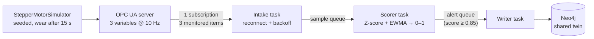

# 🛡️ BioPrint-Guard

**Async OPC UA predictive maintenance: a rolling multivariate Z-score with EWMA, and an optional Isolation Forest.**

A simulated OPC UA server publishes a gantry stepper motor's current, housing temperature and vibration at 10 Hz. An async gateway subscribes to all three, scores each reading from 0 to 1, and raises a maintenance alert in the same Neo4j twin that [GraphPrint-Twin](../01_graphprint_twin) writes to, before the motor reaches full wear.

> Simulated motor. The operating point, noise and fault response are placeholder values chosen to make the scenario readable; none comes from a real drive. Questions for reviewers on multi-robot scaling and OPC UA companion specs are in the [reviewer guide](../../docs/reviewers.md).


## How it works



| Piece | What it does |
|---|---|
| **Motor model** (`motor_model.py`) | Seeded, simulated clock. Healthy signals are stationary with Gaussian noise (an optional benign temperature drift exists for testing). After 15 s a wear level ramps from 0 to 1 over 10 s: current and vibration frequency rise with it, vibration gets noisier, and housing temperature follows with a 12 s thermal lag. |
| **OPC UA server** (`opcua_server.py`) | `Objects/FactoryFloor/ExtrusionGantry/StepperMotor` with `motor_current`, `housing_temp` and `vibration_frequency` in the `urn:bioprint:guard` namespace. The three values of one reading share a source timestamp. |
| **Detector** (`anomaly_detector.py`) | Default: **rolling multivariate Z-score + EWMA**. A 100-reading (10 s) reference window gives each signal's mean and SD. Each reading becomes three Z-scores, combined into one distance and smoothed with an EWMA (α = 0.15); a logistic curve maps that to a 0–1 risk score. `--baseline frozen` fixes the window instead of rolling it, and `--detector iforest` swaps in a scikit-learn Isolation Forest. |
| **Gateway** (`gateway.py`) | Three `asyncio` tasks joined by queues. One subscription carries all three variables; readings are reassembled by source timestamp. A lost session is retried with exponential backoff (0.5 s doubling to 10 s). |
| **Alert store** (`alert_store.py`) | Parameterised Cypher in managed transactions. At most one `OPEN` `MaintenanceAlert` per component: the first crossing creates it and later scores only raise its peak and severity. |

**How the rolling baseline avoids learning the fault.** A rolling window follows slow, harmless change, such as the housing warming with the factory through the day. The risk is that it also follows a fault until the fault looks normal. Two guards prevent that:

- **Lag.** A reading waits 5 s before it can enter the window, so the limits always describe the motor a few seconds ago, not now.
- **Hold.** While the smoothed distance is above 2 SDs (a healthy motor sits near 1), the window stops admitting readings and discards the ones still waiting.

By the time wear would reach the window, the hold has already engaged, so the limits stay at their healthy values for the whole fault.

**Choosing a baseline or detector**

| Option | Behaviour | Use it when |
|---|---|---|
| `--baseline rolling` (default) | Follows benign drift; held during a fault | The operating point moves slowly for harmless reasons |
| `--baseline frozen` | Limits fixed from the first 10 s and never changed, the way a clinical lab fixes control limits from a stable run of control material | Any drift from the commissioning state matters, including very slow wear |
| `--detector iforest` | Isolation Forest trained on the first 10 s; no assumption about each signal's distribution; limits fixed once trained | Signals are not roughly Gaussian or interact in ways per-signal Z-scores miss |

The test suite pins the trade-off in both directions. With the housing warming 2 °C over 10 minutes and no fault, rolling raises no alert and frozen does. With wear that takes 20 minutes to develop, frozen catches it and rolling adapts to it and stays silent. Neither is right for every machine, which is why both are selectable.

**Why EWMA.** One noisy reading should not page a maintenance planner. The EWMA responds to a sustained shift within a couple of seconds and ignores a single spike, which the test suite checks directly.

## Results (seed 42)

| Check | Target (PRD) | Result |
|---|---|---|
| FR-1 Address space | FactoryFloor → ExtrusionGantry → StepperMotor | ✅ three Double variables |
| FR-2 Subscription | one subscription for all three variables | **1 subscription, 3 monitored items, 300 / 300 readings, 0 lost** |
| FR-2 Reconnect | retry with backoff | ✅ tested: server absent at start, and server restarted mid-run |
| FR-3 Healthy baseline | score < 0.5 | **peak 0.017** |
| FR-3 After wear onset | score > 0.85 | **crossed at 19.0 s, 4.0 s after onset, at 40 % wear** |
| FR-4 Alert | exactly one `OPEN` alert, no duplicate component | ✅ one create plus a few peak updates for the whole fault, not one write per sample |

| Detector (30 seeds) | Healthy peak score | Alert after onset |
|---|---|---|
| Rolling Z-score + EWMA (default) | 0.014 | 3.4 to 4.2 s |
| Frozen Z-score + EWMA | 0.014 | 3.5 to 4.4 s |
| Isolation Forest + EWMA | 0.14 | 2.1 to 3.0 s |

All three alert well before wear completes at 25 s, and a healthy motor run for 10 simulated minutes raises no alert with the default detector. The Isolation Forest reacts sooner but sits closer to the 0.5 healthy ceiling.

## Run it

```bash
cd projects/03_bioprint_guard
pip install -r requirements-dev.txt

python src/app.py                 # 30 s in real time: server + gateway in one process
python src/app.py --speed 10      # the same 300 readings in about 3 s
python src/app.py --baseline frozen    # fixed limits instead of rolling ones
python src/app.py --detector iforest   # Isolation Forest (needs scikit-learn)
python -m pytest                  # 79 tests (4 need a live Neo4j and are skipped without one)
```

`app.py` writes `output/guard_scores.csv`, `output/guard_risk_score.png` and `output/acceptance.json`, and exits non-zero if any requirement fails.

**With Neo4j** (from the repo root: `docker compose up -d neo4j`), the alert lands in the shared twin:

```bash
export NEO4J_URI=bolt://localhost:7687
python src/app.py --speed 10
python src/app.py --speed 10 --close-alerts   # mark the inspection done, then run again
```

Without `NEO4J_URI`, alerts are kept in memory with the same one-open-alert rule and FR-4 is checked against that.

**As two processes**, the way it would be deployed:

```bash
python src/opcua_server.py --duration 30 --start-delay 5 &          # terminal 1
python src/gateway.py --samples 300 --duration 60 --require-alert   # terminal 2
```

Then, in the Neo4j browser:

```cypher
MATCH (p:RoboticPrinter)-[:HAS_COMPONENT]->(c:Component)-[:REQUIRES_INSPECTION]->(a:MaintenanceAlert)
RETURN p.id, c.id, a.status, a.severity, a.peak_risk_score, a.created_at;
```

## Requirements map

| Requirement | Code | Checked by |
|---|---|---|
| FR-1 OPC UA server and node path | `opcua_server.py` | `test_gateway.py::test_fr1_address_space_and_variables` |
| FR-2 Single subscription, reconnect with backoff | `gateway.py` (`_subscribe`, `_intake`, `Backoff`, `SampleAssembler`) | `test_gateway.py` (round trip, late server, server restart, slow database) |
| FR-3 Score < 0.5 healthy, > 0.85 after onset | `anomaly_detector.py` | `test_anomaly_detector.py` (30 seeds, 10 healthy minutes, single-spike immunity, rolling vs frozen, Isolation Forest) |
| FR-4 One `OPEN` alert, no duplicate component | `alert_store.py` | `test_alert_store.py`; `test_integration.py` against live Neo4j |

## Known limitations

- **One motor, one component.** The node path and component id are fixed. The multi-robot scaling question (one server per robot, an aggregating server, or MQTT/Sparkplug B) is open and listed for reviewers.
- **Custom information model.** The address space is not built on the OPC 40001-1 Machinery or OPC 40010 Robotics companion specs, and alerts are not also raised as OPC UA Alarms & Conditions. See [standards alignment](../../docs/standards-alignment.md).
- **No security.** The server accepts anonymous sessions with no security policy. A real deployment needs Basic256Sha256 and certificates.
- **Slow wear and the rolling baseline.** Wear that develops over many minutes is absorbed by the default rolling window (a test demonstrates it). Use `--baseline frozen` where that matters.
- **Isolation Forest is trained once** on 100 readings and never retrained; its thresholds were set against this simulated motor.
- **The fault is a clean ramp.** Real wear is slower and less tidy, and "vibration frequency" stands in for a proper spectrum. The detector has not been tested on recorded motor data.
- **Alert lead time is in seconds** because the whole fault is compressed into 10 s for the demo. It says nothing about lead time on a real machine.
- **Alerts are closed manually** (`--close-alerts`); there is no link to a maintenance system.
